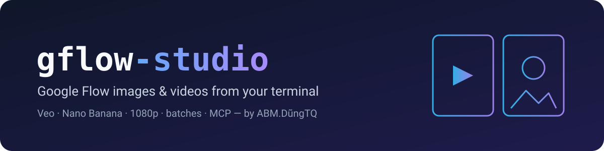

# gflow-studio

<p align="center"></p>

[Tiếng Việt](README.md) · **English**

Generate images and videos with [Google Flow](https://labs.google/fx/tools/flow) from your terminal. gflow-studio drives Imagen and Nano Banana (images) and Veo / Omni Flash (videos) through your own Flow account, so a whole storyboard can run as one batch command instead of an afternoon of clicking.

**gflow-studio** is built and maintained by **ABM.DũngTQ** for an animation pipeline: 1080p downloads, a hidden browser on macOS, batches that stop when Google pushes back, and a video batch runner. The command is `gflow`. Highlights are under [Highlights](#highlights).

[](https://github.com/abm-dungtq/gflow-studio/releases)
[](LICENSE)


[What it does](#what-it-does) · [Highlights](#highlights) · [Setup](#setup) · [Usage](#usage) · [Batches](#batches) · [Hiding the browser](#hiding-the-browser) · [Demo](#demo) · [When something fails](#when-something-fails) · [Documentation](#documentation) · [Author](#author)

> ⚠️ **Read this before you install.** gflow-studio is not affiliated with Google. It reverse-engineers Flow and drives a real Chrome window signed in to *your* Google account, so automation happens on your account and under Google's terms. Flow can change its pages at any time. Images are free; Veo video generation spends your Flow credits. Read the [DISCLAIMER](DISCLAIMER.md) and [docs/ACCOUNT_SAFETY.md](docs/ACCOUNT_SAFETY.md).

## What it does

| You want to… | Command |
|---|---|
| Generate an image from text | `gflow image t2i "a red paper lantern on a wooden table"` |
| Edit or combine images | `gflow image i2i "same cat, now wearing a scarf" --ref cat.png` |
| Make a video from text | `gflow video t2v "slow push-in on a forest clearing" --aspect 16:9` |
| Animate a still image | `gflow video i2v "the lantern sways" --initial-frame lantern.jpg` |
| Make a video from reference images | `gflow video r2v "..." --ref hero.png --ref room.png` |
| Get the clip in 1080p | add `--upscale` to `t2v`, `i2v`, `r2v` or `video batch` |
| Run a whole image storyboard | `gflow run --config storyboard.json` |
| Run many image-to-video clips in one session | `gflow video batch --config videos.json` |
| Keep the same character across shots | `gflow character create ...`, then reference it |
| Extend a clip past 8 seconds | `gflow video extend <media_id> "the camera keeps rising"` |
| Check your Veo credits | `gflow credits user` |
| Let an AI agent use Flow | `gflow mcp run` (stdio) or `gflow serve` (HTTP) |
| Diagnose your setup | `gflow doctor` |

Every command takes `--profile` to pick a Google account and `--project` to work inside an existing Flow project. Most commands take `--json` for scripts. `gflow docs` prints the bundled documentation offline.

## Highlights

- **`--upscale`: keep the 1080p clip.** After a video downloads, Flow's 1080p export (no extra credits) replaces the 720p file at the same path. If the export fails, the 720p clip is kept and the command prints a retry command. Works on `video t2v`, `i2v`, `r2v`, `video batch` and the MCP tool `gflow_generate_video(upscale=True)`.
- **`gflow video batch`.** Runs 1–50 image-to-video rows from a JSON file in one browser session and one Flow project, with `--resume`, `--jitter` and `--json`. A clip that was generated and billed but failed to download is fetched again for free instead of being lost.
- **A hidden browser on macOS.** `GFLOW_CLI_WINDOW_MODE=background` runs Chrome as a background-only app: no Dock icon, and it does not take keyboard focus while you work.
- **Batches stop when Google pushes back.** `gflow run`, `image batch` and multi-prompt `image t2i` stop at the first WAF 403, rate limit or expired session, even with `--continue-on-error`, and exit with that error's code. A flagged account no longer receives the rest of the batch.
- **Named references in `gflow run`.** Give a reference image a name (`{"name": "cuong", "path": "cuong.png"}`) and write `@cuong` in the prompt. A row can take several references (`refs`) and its own `output` path.
- **Automatic session renewal.** If the Google session expired before anything was submitted, gflow renews it once and retries. It never retries after a generation was sent. Turn it off with `GFLOW_CLI_AUTO_RENEW=false`.
- **Fixes.** `-o` on another disk no longer fails after generation. Long image batches re-upload a reference that scrolled out of the project. The Chrome tab is brought forward only when it is actually hidden.

[CHANGELOG.md](CHANGELOG.md) § Unreleased has the details. The headless measurements behind the browser work are in [docs/superpowers/spikes/2026-10-28-headless-generation.md](docs/superpowers/spikes/2026-10-28-headless-generation.md).

## Setup

### Requirements

- A Google account with access to Google Flow. Video generation needs Flow credits.
- [Google Chrome](https://www.google.com/chrome/) installed normally.
- [uv](https://docs.astral.sh/uv/getting-started/installation/), which installs Python 3.11+ for you.
- macOS, Windows or Linux with a desktop. Chrome must be able to open a window for the one-time sign-in.

### 1. Install

```bash
uv tool install "git+https://github.com/abm-dungtq/gflow-studio.git@main"
uvx --from "git+https://github.com/abm-dungtq/gflow-studio.git@main" playwright install chromium
gflow --version
```

To upgrade later, run the same `uv tool install` command with `--force`.

### 2. Sign in once

```bash
gflow auth login --browser chrome --profile main
```

A Chrome window opens. Sign in to Google and wait until the Flow workspace appears; gflow saves the session in its own profile folder. `--browser chrome` matters: generation later reopens the profile as real Chrome. Repeat with another `--profile` name for each Google account.

### 3. Check

```bash
gflow auth status
gflow credits user --profile main
gflow doctor
```

None of these spend credits. `gflow doctor` exits 33 when it finds something to fix and tells you what.

### 4. Optional settings

Copy [`.env.template`](.env.template) to `.env` in the folder you run gflow from, or to the gflow home folder for a machine-wide setting. Useful ones:

| Setting | What it does |
|---|---|
| `GFLOW_CLI_WINDOW_MODE=background` | macOS: run Chrome hidden, without taking focus |
| `GFLOW_CLI_OUTPUT_DIR=./out` | Where files go when you do not pass `-o` |
| `GFLOW_CLI_PROJECT=<id>` | Default Flow project, so runs stop creating new ones |
| `GFLOW_CLI_JITTER_RANGE=10-30` | Pause between batch submissions; widen it if you see WAF 403s |
| `GFLOW_CLI_LEASE_WAIT_SECONDS=600` | Wait for a profile another gflow command is using instead of failing |

Every setting is documented in [docs/CONFIGURATION.md](docs/CONFIGURATION.md). Only `.env` is read; a `.env.local` file is ignored.

## Usage

### Images (free)

```bash
gflow image t2i "a hot air balloon over Tokyo at sunrise" --aspect 16:9 -o out/balloon.png
gflow image t2i "a cat mom, flat 2D" --model nano2 -n 4 --out out/cats/
gflow image i2i "the same cockroach, now sitting on a keyboard" --ref refs/cuong.png -o out/k1.png
```

Models: `nano2` (Nano Banana 2.1, default), `nano2-lite`, `nano-pro`, `imagen4`. Aspect ratios: `16:9`, `4:3`, `1:1`, `3:4`, `9:16`. `-n` makes 1–4 variations.

### Videos (spend credits)

```bash
gflow video t2v "slow cinematic push-in on a sunlit forest clearing" --aspect 16:9 -o out/forest.mp4
gflow video i2v "the paper lantern sways gently, slow push in" \
  --initial-frame out/lantern.jpg --model veo-lite --aspect 16:9 --upscale -o out/lantern.mp4
gflow video upscale <media_id> --scale 1080p      # 1080p for a clip you already made
```

Models: `omni-flash`, `veo-lite`, `veo-fast`, `veo-quality`. `--duration` is 4, 6 or 8 seconds; 10 seconds is Omni Flash only. `--end-frame` sets the last frame for `i2v`.

### Projects, characters and catalog

```bash
gflow project list --profile main          # projects gflow knows about
gflow character create --project <id> --name "Aria" --face-prompt "..." --body-prompt "..."
gflow data --help                          # query everything you generated
```

### For AI agents (MCP)

```bash
gflow mcp setup          # register the stdio server with your agent
gflow mcp run --no-spend # a server without the generation tools
```

The CLI and the MCP server expose the same features. [docs/MCP.md](docs/MCP.md) lists every tool.

## Batches

### An image storyboard: `gflow run`

`storyboard.json`:

```json
{
  "prompts": [
    {"text": "@cuong stands on a desk at night, flat 2D", "aspect_ratio": "16:9",
     "refs": [{"name": "cuong", "path": "refs/cuong.png"}], "output": "gen/k1.jpg"},
    {"text": "@cuong jumps onto the keyboard", "aspect_ratio": "16:9",
     "refs": [{"name": "cuong", "path": "refs/cuong.png"}], "output": "gen/k2.jpg"}
  ]
}
```

```bash
gflow run --config storyboard.json --profile main --project <id>
gflow run --config storyboard.json --profile main --project <id> --resume
```

Each reference file is uploaded once per run. `--resume` skips rows whose output already exists, so a rerun after a failure only makes what is missing.

### Image-to-video in one session: `gflow video batch`

`videos.json`:

```json
{
  "project": "<existing-flow-project-id>",
  "videos": [
    {"start": "gen/k1.jpg", "prompt": "the cockroach looks around, slow push in",
     "model": "omni-flash", "duration": 4, "aspect": "16:9", "output": "clips/v1.mp4"},
    {"start": "gen/k2.jpg", "prompt_file": "prompts/v2.txt",
     "model": "omni-flash", "duration": 6, "aspect": "16:9", "output": "clips/v2.mp4"}
  ]
}
```

```bash
gflow video batch --config videos.json --profile main --upscale --json
```

A submitted row is never sent twice, because a clip Flow accepted may already be billed. If a row fails, rerun with `--resume`.

## Hiding the browser

Google only serves Flow to a real browser, so gflow drives a real Chrome window. How much of it you see depends on the platform:

| Platform | Setting | Result |
|---|---|---|
| macOS | `GFLOW_CLI_WINDOW_MODE=background` | Hidden, no Dock icon, never takes focus. Recommended. |
| macOS, Windows, Linux | `offscreen` (default) | The window is minimized right after launch, even with several monitors, but Chrome takes keyboard focus when it starts. |
| any | `GFLOW_CLI_HEADLESS=true` | No window at all. Experimental, see below. |
| any | `normal` | A visible window, useful for watching a run. |

Headless real Chrome generated images 6 out of 6 times on one test account (macOS, 2026-10-28), with no 403 and no reCAPTCHA error. Headless Chrome puts `HeadlessChrome` in its user agent; gflow now replaces it with the headed Chrome string, and a run on 2026-10-30 generated an image with no window and no focus taken. Video, Windows and long-term account effects were not measured, so headed Chrome stays the supported default. Try headless on a test account first. If Chrome still shows or takes focus, on macOS or Windows, [docs/HIDDEN_BROWSER.md](docs/HIDDEN_BROWSER.md) walks through finding the cause and fixing it.

## Demo


A real two-row `gflow run` on a test account (2026-10-29, about one minute, no credits):

```text
$ gflow run --config run.json --profile thu-headless --project <project-id> --output-dir tmp/f7/out
  project: <project-id> (existing)
                                   gflow run
┏━━━┳━━━━━━━━━━━━━━━━━━━━━━━━━━━━━┳━━━━━━━┳━━━━━━━━┳━━━━━━━━━━━━━━━━━━━━━━━━━━━┓
┃ # ┃ prompt                      ┃ ratio ┃ status ┃ detail                    ┃
┡━━━╇━━━━━━━━━━━━━━━━━━━━━━━━━━━━━╇━━━━━━━╇━━━━━━━━╇━━━━━━━━━━━━━━━━━━━━━━━━━━━┩
│ 0 │ a small red paper lantern   │ 16:9  │ OK     │ tmp/f7/out/prompt_0_0.jpg │
│   │ on a wooden table, soft     │       │        │                           │
│   │ light                       │       │        │                           │
│ 1 │ a green ceramic teapot on a │ 16:9  │ OK     │ tmp/f7/out/prompt_1_0.jpg │
│   │ windowsill, morning light   │       │        │                           │
└───┴─────────────────────────────┴───────┴────────┴───────────────────────────┘

2/2 succeeded · 0 failure(s) · 0 skipped
```

The first lantern image was then animated with `gflow video i2v --model veo-lite --upscale` on the same account. The result was a 4-second clip at 1920×1080, with `"upscaled": "1080p"` in the JSON output.


## When something fails

gflow fails loudly with a stable exit code rather than resubmitting, so a broken run does not silently spend credits.

| Exit | Meaning | What to do |
|---|---|---|
| 3 / 8 | Session expired or missing | `gflow auth renew`, or `gflow auth login` again |
| 4 | Rate limited | Wait, then widen `--jitter` |
| 5 | Refused by content policy | Rephrase that prompt; batches continue past it |
| 10 | WAF 403: Google blocked the request | Stop and wait. Do not loop retries on this account |
| 11 | Configuration problem, or the profile is busy | Read the message; it names the field or the lock |
| 23 | Flow changed its page | `gflow update`, then report it |
| 37 | Not enough Veo credits | Top up, or use a cheaper model |

Every error is printed as RFC 9457 problem details with a remediation hint. [KNOWN_ISSUES.md](KNOWN_ISSUES.md) lists current problems and workarounds.

## Documentation

| Topic | Read |
|---|---|
| Getting started | [User guide](docs/USER_GUIDE.md) · [Usage, every command](docs/USAGE.md) · [Configuration](docs/CONFIGURATION.md) |
| Accounts | [Authentication](docs/AUTHENTICATION.md) · [Account safety](docs/ACCOUNT_SAFETY.md) · [Known issues](KNOWN_ISSUES.md) |
| Production | [Characters](docs/CHARACTER.md) · [Movie manifests](docs/MOVIE.md) · [Prompt tools](docs/TOOLS.md) · [Reference strategies](docs/REFERENCE_STRATEGIES.md) |
| Agents | [MCP server](docs/MCP.md) · [AGENTS.md](AGENTS.md) · [llms.txt](llms.txt) |
| Internals | [Architecture](docs/ARCHITECTURE.md) · [Development](docs/DEVELOPMENT.md) · [Changelog](CHANGELOG.md) |

[docs/INDEX.md](docs/INDEX.md) indexes everything.

## Author

- **gflow-studio:** ABM.DũngTQ · 0976202028 · [github.com/abm-dungtq/gflow-studio](https://github.com/abm-dungtq/gflow-studio)
- **License:** [MIT](LICENSE). The license covers the code only. Google's own terms govern Flow and everything you generate with it. See the [DISCLAIMER](DISCLAIMER.md).
